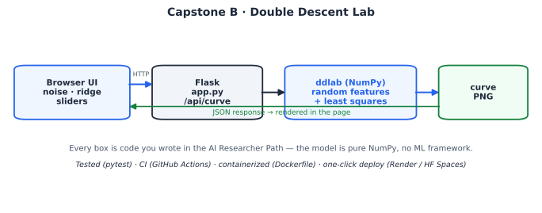

# 📉 Double Descent Lab

An **interactive, reproducible** demonstration of **double descent** — the phenomenon that overturned the textbook "bigger models always overfit" story. Drag the **noise** and **ridge** sliders and watch the test-error curve re-render live: the spike at the interpolation threshold (parameters = data points) appears, then a second descent follows as the model grows.

This is **Capstone B** of the [AI Researcher Path](../../researcher-path.html) — the **Track 8** reproduction, hardened into a tested, deployable research artifact. It shows the other half of the capstone skill set: not shipping a product, but packaging a *scientific result* so anyone can re-run it and probe it.



---

## What it demonstrates

- A **faithful reproduction** of double descent (Belkin et al. 2019; Nakkiran et al. 2019) with random ReLU features + least squares — pure NumPy.
- An **interactive web app**: sliders for label noise and ridge regularization re-compute the curve server-side and stream back a fresh plot.
- **Tests that encode the science**: the suite asserts the peak sits near P/n = 1, that a second descent follows, and that *raising the ridge penalty removes the spike* — a controlled ablation of the mechanism.
- Full deployable packaging: CI, Dockerfile, one-click host configs.

---

## Quickstart (local)

```bash
git clone https://github.com/<your-username>/double-descent-lab.git
cd double-descent-lab
pip install -r requirements.txt

# run the interactive app
python app.py            # open http://localhost:8000

# or reproduce the result headless
python -c "from ddlab.experiment import double_descent_curve; \
           r,e=double_descent_curve(); print(list(zip(r,e)))"

# run the test suite (verifies the phenomenon)
pip install pytest && pytest -q
```

---

## The science, in one paragraph

Classical theory predicts a U-shaped test-error curve: more capacity eventually overfits. Double descent shows this is only the **left half** of the picture. Exactly at the **interpolation threshold** — when the model has just enough parameters to fit the training data — there is essentially one wildly contorted fit, and test error **spikes**. Push past it and many interpolating solutions exist; least squares picks the smoothest (minimum-norm) one, so test error **descends again**. The `test_large_ridge_suppresses_peak` test proves the mechanism: regularization prevents exact interpolation, and the spike disappears.

---

## API

| Endpoint | Description |
|---|---|
| `/` | Interactive UI |
| `/api/curve?noise=<0–2>&ridge=<1e-7–10>` | Returns JSON `{image, peak_ratio, peak_error}`; `image` is a base64 PNG of the curve |
| `/health` | Liveness probe |

---

## Project layout

```
double-descent-lab/
├── app.py                   # Flask app; renders the curve as a PNG per request
├── ddlab/experiment.py      # the reproducible experiment (pure NumPy)
├── templates/index.html     # slider UI
├── tests/test_experiment.py # tests that encode the expected phenomenon
├── Dockerfile  Procfile  requirements.txt
└── .github/workflows/ci.yml
```

---

## Deploy it

**Push to GitHub:**
```bash
git init && git add . && git commit -m "Double Descent Lab"
git branch -M main
git remote add origin https://github.com/<your-username>/double-descent-lab.git
git push -u origin main
```
CI runs the test suite (and therefore re-verifies the scientific claim) on every push.

**Render:** New → Web Service → connect repo →
- Build: `pip install -r requirements.txt`
- Start: `gunicorn app:app --bind 0.0.0.0:$PORT --timeout 120`

**Hugging Face Spaces (Docker):** New Space → Docker → push this repo; the included `Dockerfile` builds and serves it.

**Docker locally:**
```bash
docker build -t double-descent-lab . && docker run -p 8000:8000 double-descent-lab
```

---

## Extend it

- Add a slider for the number of training points `n` and watch the threshold move with it.
- Replace random ReLU features with random Fourier features and compare the curves.
- Add **epoch-wise** double descent (vary training time instead of width) for a second, dynamic version of the effect.

## License

MIT — see [LICENSE](LICENSE).
