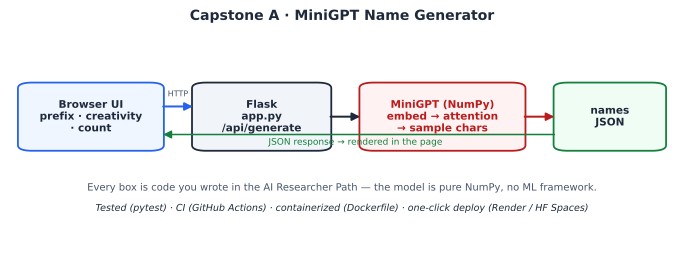

# 🧬 MiniGPT Name Generator

A **real-time name generator** powered by a character-level Transformer written **from scratch in ~120 lines of NumPy** — no PyTorch, no TensorFlow. Type a prefix, set the "creativity" dial, and watch novel names get sampled one character at a time from the model's learned next-character distribution.

This is **Capstone A** of the [AI Researcher Path](../../researcher-path.html). It packages the single-head Transformer you build in **Track 5** (with the autograd ideas from **Track 4**) into a deployable web service with tests, CI, and a Dockerfile — the full path from *"I implemented attention"* to *"I shipped it."*



---

## What it demonstrates

- A working **causal self-attention Transformer** (embedding → one attention head → output projection) with **hand-derived backprop**, trained by Adam — all in NumPy.
- **Autoregressive generation**: each name is sampled token-by-token, feeding each character back as context (the Track 6 idea).
- A clean **Flask API** (`/api/generate`) and a zero-dependency **web UI**.
- **Production-ready packaging**: unit tests, GitHub Actions CI, a Dockerfile, and one-click deploy configs.

> The model is deliberately tiny (vocab ≈ 26, context 16, embedding dim 48) so it trains in seconds on a CPU and the whole repo is a few hundred kilobytes. It generates *plausible-sounding new names* (e.g. `Alexan`, `Mica`, `Casana`), not a production language model — the point is to own every line end to end.

---

## Quickstart (local)

```bash
# 1. clone and enter
git clone https://github.com/<your-username>/minigpt-namegen.git
cd minigpt-namegen

# 2. install (a virtualenv is recommended)
pip install -r requirements.txt

# 3. train the tiny model (~10–30s on a laptop CPU) -> writes model.npz
python -m minigpt.train

# 4. run the web app
python app.py
# open http://localhost:8000
```

If you skip step 3, the app trains the model automatically on first boot.

Run the tests:

```bash
pip install pytest
pytest -q
```

---

## API

| Endpoint | Method | Description |
|---|---|---|
| `/` | GET | The web UI |
| `/api/generate` | GET | Returns JSON `{names: [...]}`. Query params: `count` (1–20), `temperature` (0.1–1.5), `prefix` (letters only) |
| `/health` | GET | Liveness probe — returns model dimensions |

```bash
curl "http://localhost:8000/api/generate?count=5&temperature=0.9&prefix=al"
# {"names":["Alexan","Alile","Alah",...],"temperature":0.9,"prefix":"al"}
```

---

## Project layout

```
minigpt-namegen/
├── app.py                 # Flask server: /, /api/generate, /health
├── minigpt/
│   ├── model.py           # the Transformer + train/save/load/sample (pure NumPy)
│   └── train.py           # trains on data/names.txt -> model.npz
├── templates/index.html   # web UI (vanilla JS fetch)
├── static/style.css
├── data/names.txt         # training corpus (one name per line)
├── tests/test_model.py    # pytest unit tests
├── Dockerfile             # production image (trains model at build)
├── Procfile               # for Render / Heroku-style platforms
├── requirements.txt
└── .github/workflows/ci.yml
```

---

## Deploy it

You can push this to GitHub and have a public URL in a few minutes. Three good options:

### A. Push to GitHub first

```bash
git init
git add .
git commit -m "MiniGPT name generator"
git branch -M main
git remote add origin https://github.com/<your-username>/minigpt-namegen.git
git push -u origin main
```

The CI workflow (`.github/workflows/ci.yml`) runs the test suite on every push automatically.

### B. Deploy to Render (free tier, no Docker knowledge needed)

1. Go to **[render.com](https://render.com)** → **New** → **Web Service**, and connect your GitHub repo.
2. Render auto-detects Python. Set:
   - **Build Command:** `pip install -r requirements.txt && python -m minigpt.train`
   - **Start Command:** `gunicorn app:app --bind 0.0.0.0:$PORT --timeout 120`
3. Click **Create Web Service**. Render builds, trains the model, and gives you a `https://your-app.onrender.com` URL.

(The included `Procfile` also works on any Heroku-style platform.)

### C. Deploy to Hugging Face Spaces (Docker)

1. Create a new **Space** at **[huggingface.co/new-space](https://huggingface.co/new-space)** → choose **Docker** → **Blank**.
2. Push this repo to the Space (it ships a `Dockerfile`):
   ```bash
   git remote add space https://huggingface.co/spaces/<user>/minigpt-namegen
   git push space main
   ```
3. The Space builds the image (training the model during build) and serves it. Spaces route to the container's exposed port automatically.

### D. Run the Docker image anywhere

```bash
docker build -t minigpt-namegen .
docker run -p 8000:8000 minigpt-namegen
# http://localhost:8000
```

---

## How it works (the 60-second version)

1. **Tokenize** the names corpus into characters; each character is an integer id.
2. **Embed** each id and add a learned positional vector (so order matters).
3. **One causal self-attention head** lets each position attend to earlier ones; a softmax over the resulting scores blends value vectors.
4. **Project** to vocabulary logits, softmax to a next-character distribution, and train with **cross-entropy + Adam**, using **gradients derived by hand** in `model.py`.
5. **Generate** by starting at the newline boundary and sampling characters until the next newline — that's one name.

Every step is in `minigpt/model.py`, short enough to read in one sitting. To go deeper, see Tracks 4–6 of the AI Researcher Path.

---

## Make it yours

- Swap `data/names.txt` for **anything** line-delimited — Pokémon, startup names, song titles, chemical compounds — and retrain.
- Raise `d` (embedding dim) and `steps` in `minigpt/train.py` for sharper samples.
- Add a second attention head or a feed-forward block (Track 5, Lesson 2) to increase capacity.

## License

MIT — see [LICENSE](LICENSE).
