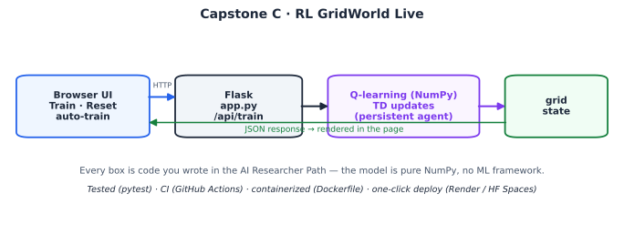

# 🤖 RL GridWorld — Live

Watch a **Q-learning agent learn in your browser**. Click *Train* and the value heatmap and policy arrows sharpen episode by episode as the agent discovers — from reward alone, with no model of the world — how to reach the goal and avoid the pit.

This is **Capstone C** of the [AI Researcher Path](../../researcher-path.html): the **Track 7** reinforcement-learning algorithm, turned into a live, interactive, deployable visualization. It's the most *dynamic* of the capstones — you don't just see a result, you watch learning happen.



---

## What it demonstrates

- **Tabular Q-learning** from scratch (NumPy): temporal-difference updates, ε-greedy exploration, exploring starts — the model-free control algorithm from Track 7.
- **Incremental training over HTTP**: the agent persists server-side, so each *Train* click runs more episodes and returns the updated value/policy grid as JSON.
- A **live visualization**: cells colored by learned state value, arrows showing the current greedy action, plus an auto-train mode that animates convergence.
- Deployable packaging: tests that assert the agent actually *learns*, CI, Dockerfile, host configs.

---

## Quickstart (local)

```bash
git clone https://github.com/<your-username>/rl-gridworld-live.git
cd rl-gridworld-live
pip install -r requirements.txt
python app.py            # open http://localhost:8000  → click "Train"

pip install pytest && pytest -q
```

---

## How it works

The environment is a 4×4 grid with a goal (+1), a pit (−1), a wall, and "slippery" moves (you go where you intend 80% of the time, else slip sideways). The agent keeps a table `Q[state, action]` and, after each step, applies the temporal-difference update:

```
Q[s,a] ← Q[s,a] + α · ( r + γ · max_a' Q[s',a'] − Q[s,a] )
```

It explores with an ε-greedy policy and uses *exploring starts* so every state gets visited. After enough episodes the greedy policy converges to ~+0.86 average return from the start — the optimum for this slippery world. The `test_learning_improves_return` test asserts exactly this improvement, so CI fails if learning ever breaks.

---

## API

| Endpoint | Description |
|---|---|
| `/` | Live UI |
| `/api/train?episodes=<1–2000>` | Train more episodes; returns the updated grid state (values + policy) |
| `/api/reset?seed=<int>` | Reset the agent |
| `/api/state` | Current grid state without training |
| `/health` | Liveness probe |

The grid state JSON: `{rows, cols, episodes, return, cells:[{r,c,kind,value,policy}]}`.

---

## Project layout

```
rl-gridworld-live/
├── app.py                 # Flask app; persistent agent, train/reset/state endpoints
├── rlgrid/agent.py        # GridWorld MDP + Q-learning agent (pure NumPy)
├── templates/index.html   # live grid visualization (vanilla JS)
├── tests/test_agent.py    # tests that the agent actually learns
├── Dockerfile  Procfile  requirements.txt
└── .github/workflows/ci.yml
```

---

## Deploy it

**GitHub:**
```bash
git init && git add . && git commit -m "RL GridWorld Live"
git branch -M main
git remote add origin https://github.com/<your-username>/rl-gridworld-live.git
git push -u origin main
```

**Render:** New → Web Service → connect repo →
- Build: `pip install -r requirements.txt`
- Start: `gunicorn app:app --bind 0.0.0.0:$PORT --timeout 120`

> Note: this app keeps the agent in memory, so run it as a **single worker** (the default start command does). For multi-worker hosting you'd move the Q-table to a shared store (Redis) — a nice extension exercise.

**Hugging Face Spaces (Docker):** New Space → Docker → push this repo (ships a `Dockerfile`).

**Docker locally:**
```bash
docker build -t rl-gridworld-live . && docker run -p 8000:8000 rl-gridworld-live
```

---

## Extend it

- Let the user **edit the grid** (drag the goal/pit, add walls) and retrain — the agent adapts.
- Add a **slippiness slider** and watch how a noisier world changes the optimal (more cautious) policy.
- Swap the heatmap for **Q-values per action** (four triangles per cell) to see the full action-value function.
- Add a second agent using **SARSA** (on-policy) and compare the policies it learns.

## License

MIT — see [LICENSE](LICENSE).
